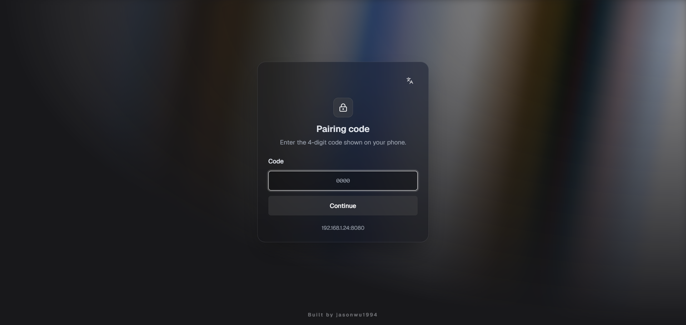
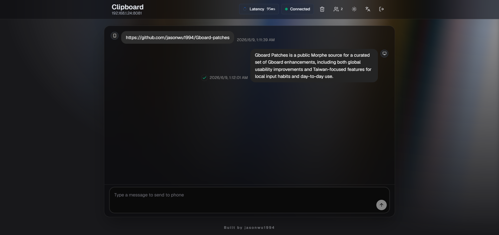

<h1 align="center">Gboard Patches JP</h1>

<p align="center">
  全世界向けの機能改善と日本語入力向けの独自機能を搭載した、Gboard 用 Morphe パッチ集
</p>

## 概要

Gboard Patches JP は、[jasonwu1994/Gboard-patches](https://github.com/jasonwu1994/Gboard-patches) のフォークです。上流の全パッチに加え、日本語入力向けの独自機能（日本語 QWERTY のグライド入力、拡張辞書）を搭載した Morphe ソースとして公開しています。

Patches 設定画面は日本語を含む 13 言語に対応しており、日本語訳は上流の翻訳を採用しています。上流の英語版 README は [docs/upstream-README.md](docs/upstream-README.md) に収録しています。

## 収録パッチ

各項目の名称は、Morphe 上で表示されるパッチ名です。

### 独自実装の機能

Gboard 既存のフラグ解放ではなく、本プロジェクト（上流を含む）で設計・実装した機能です。

<details>
  <summary><code>Dictionaries &amp; Predictions</code></summary>

  辞書、予測変換、入力補正の各リソースのバージョンを選択します。
</details>

<details>
  <summary><code>Clipboard Enhancements</code></summary>

  クリップボードの保持期間、保存件数の上限、プレビュー行数、残り時間・作成日時の表示、番号表示、グリッド列数を拡張します。各カードの描画を先頭 1,000 文字に限定する設定にも対応します。
</details>

<details>
  <summary><code>Web Clipboard</code></summary>

  スマートフォン上で Web Clipboard ポータルを起動し、同一 LAN 内のデスクトップブラウザと Gboard 間でクリップボードを同期します。ペアリングコードによる認証と、クイック設定タイルにも対応します。

  プレビュー：

  

  

</details>

<details>
  <summary><code>Floating Web Search</code></summary>

  Gboard からフローティング表示の Web ページを直接起動し、必要な情報を即座に検索します。
</details>

<details>
  <summary><code>Custom Theme</code></summary>

  独自の ZIP テーマや、公式 Rboard リポジトリのテーマを導入します。
</details>

<details>
  <summary><code>Frosted Glass</code></summary>

  キーボード背景のリアルタイムぼかし効果と、カスタムテーマの透過表示を追加します。Android 12 以降かつウィンドウ間ぼかし対応端末で、Animal Black などのカスタムテーマと併用可能です。
</details>

<details>
  <summary><code>FTP Server</code></summary>

  スマートフォン上で FTP サーバーを起動し、同一 LAN 内のデスクトップ FTP クライアントからファイルの閲覧、アップロード、ダウンロード、転送再開を実行します。匿名接続とパスワード認証、制御ポートとパッシブポート範囲の設定、読み取り専用モード、ルートフォルダー（<code>/sdcard</code> または任意のフォルダー）の指定、転送進捗のリアルタイム表示、中断済みアップロードの保持、クイック設定タイルに対応します。
</details>

<details>
  <summary><code>Long-Press Editing Shortcuts</code></summary>

  英語 QWERTY と注音キーボードに、全選択、元に戻す、コピー、切り取り、貼り付け、やり直しの長押しショートカットを追加します。対応する英字レイアウト間で同一の物理キー位置に追従する、地球儀キーのドラッグ操作にも対応します。
</details>

<details>
  <summary><code>Toolbar Editing Buttons</code></summary>

  全選択、コピー、切り取り、貼り付け、前方削除、行頭／行末、Tab、方向キーなどの編集・カーソル操作ボタンをメニューへ追加します。上部ツールバーへドラッグで配置し、対応エディター上で各キーボード言語と併用可能です。ボタン表示名は Patches 設定画面の言語設定に追従します。
</details>

<details>
  <summary><code>Swipeable Custom Top Row</code></summary>

  キーボード最上段の横スワイプで、カスタムテキストと JavaScript のスロットを表示します。
</details>

<details>
  <summary><code>Incognito Mode Toggle</code></summary>

  アクセスポイントのツールバーへシークレットモードの切替ボタンを追加し、シークレットモード中のクリップボードと音声入力の利用可否を設定します。
</details>

<details>
  <summary><code>Custom Symbols</code></summary>

  専用の記号タブと、読点キー長押しポップアップからの即時起動項目を追加します。
</details>

<details>
  <summary><code>Simple Calculator</code></summary>

  任意のテキスト欄へ入力した四則演算式の計算結果を、Gboard の候補バーへ表示する計算機能を追加します（任意設定）。タップで式を計算結果へ置換し、長押しで計算結果をコピーします。
</details>

<details>
  <summary><code>Swipe Down to Dismiss Keyboard</code></summary>

  候補バーまたはツールバーの下方向スワイプでキーボードを非表示にします。
</details>

<details>
  <summary><code>Shift + Backspace Forward Delete</code></summary>

  Shift キーの押下中に Backspace キーを押すと、パソコンの Delete キーと同様に、カーソル直後の文字を削除します。
</details>

<details>
  <summary><code>G Logo on Spacebar</code></summary>

  スペースキー上に内蔵アイコン、または任意の PNG・WebP・JPEG 画像を表示します。元の配色の維持または単色化、表示サイズの調整、設定バックアップへの画像の同梱に対応します。
</details>

<details>
  <summary><code>Rounded Keyboard Panel</code></summary>

  キーボードパネルの角丸対象の角を選択し、上部と下部の半径を個別に設定します。
</details>

<details>
  <summary><code>Latin Globe Key Ignore Interval</code></summary>

  文字入力直後の言語切替遅延について、英語キーボード専用の地球儀キー無視時間を個別に設定します。
</details>

<details>
  <summary><code>Emojis, stickers & GIFs Tab Order</code></summary>

  Gboard の絵文字・ステッカー・GIF パネル下部のタブ順序を、ドラッグ操作で並べ替えます。
</details>

<details>
  <summary><code>Backup &amp; Restore</code></summary>

  Gboard Patches の全設定を JSON 形式でバックアップし、選択したモジュールのみを復元します。復元前に変更対象の全モジュールを一覧表示し、各モジュール画面ではキーの追加・変更・削除をフィルター付きで確認可能です。復元後はモジュール単位・キー単位で結果を表示します。

  Gboard 内蔵のバックアップ機構を利用し、Gboard 自体の個人データも ZIP ファイルへバックアップします。対象は学習済みの単語（中国語・日本語を含む）、単語リスト、ブロック済みの候補、絵文字・ステッカー・GIF の履歴、保存済みの表現画像、カスタムテーマ、固定済みのクリップボード項目、Gboard の設定です。インポート時はファイルの内容を表示し、確認後に各項目の結果を表示します。クリップボードは固定済み項目のみが対象です。設定の復元後、Gboard が連絡先へのアクセス許可を再要求する場合があります。

  Gboard の PB/XML 形式フラグストアファイルのエクスポート、比較、復元にも対応します。
</details>

<details>
  <summary><code>Extended Dictionary</code></summary>

  Gboard 標準の単語リスト形式（テキストまたは ZIP）のファイルを、単語リストへ一括インポートします。インポートした単語は単語リスト内の専用区画「（拡張）」へ格納するため、利用者自身の登録単語には影響しません。日本語の単語には品詞を付与して Mozc での利用に対応し、削除時はインポート済みの単語のみを削除します。Gboard の Mozc ユーザー辞書のインポート上限も 200,000 件から 1,000,000 件へ拡大します。日本語用の単語リスト（SudachiDict 由来、Wikidata 由来）は <a href="https://github.com/c-ardinal/gboard-extended-dictionary">c-ardinal/gboard-extended-dictionary</a> で公開しています。
</details>


### Gboard 既存機能の解放

Gboard に内蔵済みの機能を、非表示設定、段階的展開の制限、内部動作の有効化によって解放します。

<details>
  <summary><code>Keypress Vibration Intensity Control</code></summary>

  キー押下時の振動について、持続時間ではなく強度を調整します。
</details>

<details>
  <summary><code>AI Writing Tools</code></summary>

  <code>テキストの修正 &gt; 文章作成ツール</code>設定を全言語対応の状態で有効化します。
</details>

<details>
  <summary><code>Advanced Voice Typing</code></summary>

  自動句読点付きの高度な音声入力を有効化します。高度な音声入力に非対応の繁体字中国語の音声入力についても、自動句読点を個別に有効化します。
</details>

<details>
  <summary><code>Enable OCR / Scan Text</code></summary>

  ラテン文字、中国語、日本語、韓国語、デーヴァナーガリー文字の認識エンジンを搭載した OCR（テキストのスキャン）機能を有効化します。
</details>

<details>
  <summary><code>English QWERTY Up-Flick Uppercase</code></summary>

  英語 QWERTY キーボードの上フリックで、大文字と小文字を切り替えます。
</details>

<details>
  <summary><code>Enable Inline Autofill Suggestions</code></summary>

  対応箇所でのインライン自動入力候補を有効化します。
</details>

<details>
  <summary><code>Grammar Checker</code></summary>

  <code>テキストの修正 &gt; 文法チェック</code>設定と、関連する段階的展開の制限を有効化します。
</details>

<details>
  <summary><code>Inline Suggestions</code></summary>

  <code>テキストの修正 &gt; スマート作成</code>設定と、関連する段階的展開の制限を有効化します。
</details>

<details>
  <summary><code>Key Shape Selection</code></summary>

  角丸キーを既定値として強制せず、テーマ詳細内の<code>キーの形状</code>設定を有効化します。
</details>

<details>
  <summary><code>Use Bluetooth Microphone</code></summary>

  <code>音声入力 &gt; Bluetooth マイクを使用</code>設定と、関連する段階的展開の制限を有効化します。
</details>

<details>
  <summary><code>Change emoji size</code></summary>

  Gboard の絵文字サイズ設定を有効化します。
</details>

<details>
  <summary><code>Enable cursor trackpad mode</code></summary>

  スペースキー長押しのトラックパッド操作、カーソル固定モード、必須となるスクラブ移動設定を有効化します。
</details>

<details>
  <summary><code>Enable split keyboard</code></summary>

  Gboard の分割キーボードレイアウトを有効化します。
</details>

<details>
  <summary><code>Enable accessibility layout</code></summary>

  ユーザー補助レイアウトを有効化します。
</details>

<details>
  <summary><code>Quick Insert</code></summary>

  クイック挿入パネルと、ツールバーのアクセスポイントを有効化します。
</details>

<details>
  <summary><code>Close Proactive Suggestions</code></summary>

  先回り候補バーへ非表示ボタンを追加します。
</details>

<details>
  <summary><code>Clipboard Custom Character Limit</code></summary>

  テキストのクリップボード項目ごとの最大保存文字数を設定します。既定値は Gboard 標準の 20,000 文字です。
</details>

<details>
  <summary><code>Access Points menu style</code></summary>

  アクセスポイントメニューの新旧スタイルを切り替えます。
</details>

<details>
  <summary><code>Top Toolbar Item Count</code></summary>

  上部ツールバーの項目数を変更します。
</details>

<details>
  <summary><code>Settings Homepage Override</code></summary>

  Gboard 設定画面の新旧スタイルを切り替えます。
</details>

<details>
  <summary><code>Developer options</code></summary>

  開発者向けオプションと Flag エディターを有効化し、フラグ値の変更を可能にします。
</details>

<details>
  <summary><code>Package Rename</code></summary>

  パッケージ名を任意の名称（既定値は <code>dev.jason.com.google.android.inputmethod.latin</code>）へ変更し、アプリ名の変更にも対応します。公式 Gboard との同時インストールが可能です。
</details>

### 台湾向けの機能

繁体字中国語と注音入力向けの機能です。

<details>
  <summary><code>Zhuyin Slide Input</code></summary>

  注音キーボード上の上下スワイプで、キーボードレイアウトを切り替えずに英字を入力します。
</details>

<details>
  <summary><code>Zhuyin Quick Traditional/Simplified Toggle</code></summary>

  注音キーボードの <code>ㄥ</code> キーの上スワイプで、繁体字と簡体字を即座に切り替えます。
</details>

<details>
  <summary><code>Zhuyin Bottom Row Key Sizes</code></summary>

  注音キーボード最下段の 7 個のキー（<code>?123</code>、<code>，</code>、地球儀キー、スペース、<code>ㄦ</code>、Backspace、IME 操作キー）のサイズを調整します。
</details>

### 日本向けの機能

日本語入力向けの独自機能です。

<details>
  <summary><code>Japanese QWERTY Glide</code></summary>

  日本語キーボードの ABC レイアウト上で、英単語のグライド入力に対応します。入力途中の候補表示と、確定時の半角スペース挿入にも対応します。既定値は無効です。
</details>

## 導入方法

本リポジトリを Morphe のソースとして追加します。

- [Morphe で開く](https://morphe.software/add-source?github=c-ardinal/Gboard-patches-jp)
- 手動追加の場合は `https://github.com/c-ardinal/Gboard-patches-jp` を入力

## ビルド方法

ローカル環境での Gradle 実行前に、以下のいずれかの方法で Morphe の GitHub Packages レジストリへの認証情報を設定します。

- `~/.gradle/gradle.properties` へ `gpr.user` と `gpr.key` を記述
- 環境変数 `GITHUB_ACTOR` と `GITHUB_TOKEN` を設定

Android 用パッチバンドルのビルド：

```powershell
.\gradlew.bat :patches:buildAndroid
```

パッチ情報の再生成：

```powershell
.\gradlew.bat generatePatchesList
```

生成物：

- `patches/build/libs/*.mpp`
- `patches-list.json`
- `patches-bundle.json`

## ライセンス

[GNU General Public License v3.0](LICENSE) で公開しています。
